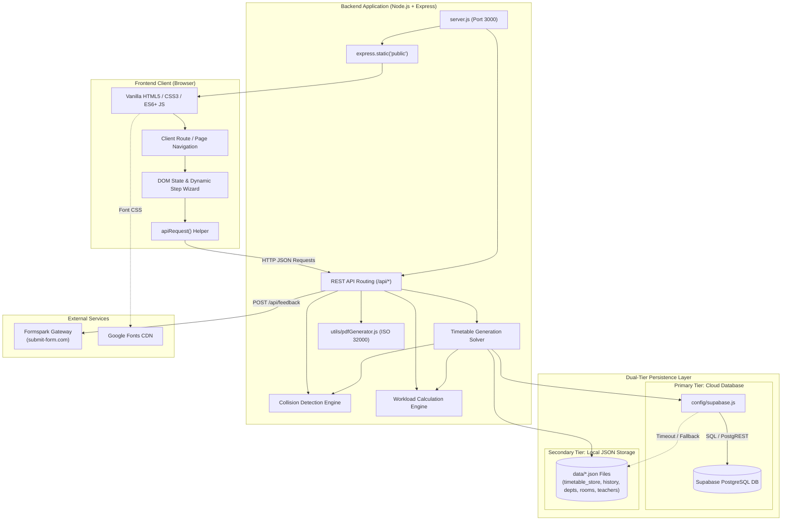

# System Architecture Documentation — SchedX

> **Document Version**: 2.0.0  
> **Status**: `Confirmed` Architecture of Existing Codebase  
> **Target Audience**: Technical Architects, Backend & Frontend Developers, System Integrators  
> **Related Documents**: [PRD.md](PRD.md) | [DATABASE.md](DATABASE.md) | [API.md](API.md) | [DESIGN.md](DESIGN.md)

---

## 1. Architectural Overview

SchedX is architected as a lightweight, high-performance, monolithic client-server web application. It deliberately avoids frontend framework bloat and microservice overhead, delivering extreme responsiveness and zero-build simplicity.

The platform employs a **Dual-Tier Resilient Persistence Architecture**:
- **Primary Tier**: Cloud-hosted **Supabase PostgreSQL** instance connecting via `@supabase/supabase-js`.
- **Secondary / Resilient Tier**: Local disk JSON store located in `data/`, managed automatically by custom persistence functions in `server.js`. If Supabase network latency exceeds defined deadlines (250ms–1000ms) or credentials are omitted, the system seamlessly fulfills read and write requests using the local JSON store without crashing.



---

## 2. Technology Stack & Runtime Environment

### Runtime & Core Modules
- **Runtime**: Node.js (v18.0.0+ supported, v20+ recommended)
- **Framework**: Express.js 4.21.2
- **Process Model**: Single-process event loop with asynchronous non-blocking I/O
- **Configuration**: `dotenv` 16.4.7 for environment variable injection
- **CORS Handling**: `cors` 2.8.5 with open development policies

### Frontend Implementation
- **Markup**: Pure HTML5 (7 distinct HTML views in `public/`)
- **Styling**: Vanilla CSS3 (`public/style.css`, 12,000+ LOC) with CSS custom properties
- **Logic**: Vanilla JavaScript (`public/script.js`, 6,000+ LOC; `public/todo.js`, 500+ LOC)
- **Network Client**: Browser-native `fetch()` wrapped in custom `apiRequest()` helper

### Persistence & Drivers
- **Cloud Database**: Supabase PostgreSQL 15+
- **Supabase SDK**: `@supabase/supabase-js` 2.57.4
- **Realtime Transport**: `ws` 8.21.3
- **Local Persistence Engine**: Native Node.js `fs` file operations on structured JSON stores (`data/`)

### Document Rendering
- **PDF Engine**: Native Node.js Buffer vector stream generator (`utils/pdfGenerator.js`), strictly conforming to ISO 32000-1 (PDF 1.4) specifications without external binary dependencies.

---

## 3. Application Entry Points & Structure

| Component | Path | Responsibility |
|---|---|---|
| **Server Entry Point** | `server.js` | Bootstraps Express, registers API routes, serves static assets from `public/`, houses solver logic, and binds to `PORT` (default: `3000`). |
| **Database Config** | `config/supabase.js` | Reads environment variables and instantiates the `@supabase/supabase-js` client with WebSocket transport. |
| **PDF Generator** | `utils/pdfGenerator.js` | Exports `generateTimetablePdf()` and `createSafePdfFilename()`. |
| **Diagnostic Tool** | `diagnose.js` | Standalone CLI utility verifying database connection and environment setup. |
| **Frontend Entry Point** | `public/index.html` | Client landing view; scripts loaded via `<script src="/script.js">`. |
| **Generator Workbench** | `public/generate.html` | 10-step wizard view; loads `script.js?v=2.2` and `todo.js`. |

---

## 4. Request & Response Lifecycle

```
[Browser Client]
       │
   HTTP Request (e.g. GET /api/timetable)
       │
       ▼
[Express Server (server.js)]
       │
   checkDatabase Middleware (Validates configuration state)
       │
   Route Handler (app.get('/api/timetable'))
       │
       ├──► Step 1: Query Supabase with Timeout (250ms deadline)
       │        │
       │        ├─► [Supabase Responded] ──► Parse rows into unified timetable schema
       │        │
       │        └─► [Timeout / Error] ────► loadTimetableLocally() reads data/timetable_store.json
       │
       ├──► Step 2: Enrich with Department & Metadata
       │
       ├──► Step 3: Run detectTimetableConflicts() to flag collision badges
       │
       ├──► Step 4: Set Headers (X-Working-Days, X-Day-Periods, X-Period-Counts)
       │
       ▼
   HTTP 200 JSON Response ([ {...}, {...} ])
       │
       ▼
[Frontend Client (script.js)]
       │
   renderTimetable() dynamically constructs Day Cards & Tables in DOM
```

---

## 5. Core Scheduling Workflows

### 5.1 Timetable Generation Solver (`generateTimetableHandler`)
Located in `server.js` (lines 2573–4248), this engine executes a multi-phase constraint allocation process:

1. **Input Normalization & Validation**:
   - Validates non-empty Department string.
   - Enforces unique faculty names and subject qualifications (or explicit `NA`).
   - Enforces the subject ceiling formula: `Max Subjects = Teachers + 2`.
   - Normalizes student sections and classroom/laboratory rooms.
   - Validates room types (`Classroom` vs `Laboratory`).
2. **Time & Period Math Slicing**:
   - Reads day-specific periods (`day_periods`) and configured working days.
   - Parses institutional breaks (`breaks`).
   - Executes `calculateDayTeachingPeriods()` to slice available working hours around break windows, generating exact start and end minute boundaries for each period.
3. **Lab Classes Scheduling (Phase 1 Priority)**:
   - Practical lab sessions are prioritized because they require continuous multi-hour blocks (2–3 periods) and specialized facilities.
   - Matches candidate laboratory rooms and verifies room capacity.
   - Slices lab sessions into exact matching period indices using `matchLabToDayPeriods()`.
4. **Theory Classes Scheduling (Phase 2)**:
   - Distributes remaining theory courses across available periods, ensuring balanced daily spread per section.
   - Evaluates teacher availability diary constraints and weekly working day limits.
   - Strictly enforces the 3-Way Collision Prevention rules.
5. **Workload Computation & Persistence**:
   - Invokes `calculateTeacherWorkload()` to calculate teaching hours per faculty.
   - Runs `detectTimetableConflicts()` to identify any remaining clashes.
   - Stores the generated schedule in `data/timetable_store.json`.
   - Appends a snapshot version to `data/timetable_history.json` (retaining up to `MAX_RETAINED_GENERATIONS = 2`).
   - Asynchronously attempts to persist generated rows into Supabase `public.timetable`.

### 5.2 Conflict Validation Engine
Located in `server.js` (`detectTimetableConflicts()` lines 1459–1634, and `validateTimetableAssignment()` lines 1268–1458):

- **Triple-Guard Checks**:
  1. **Teacher Clashes**: `teacher_name` + `day` + overlapping `start_time`/`end_time`.
  2. **Section Clashes**: `section` + `day` + overlapping `start_time`/`end_time`.
  3. **Room Clashes**: `room_name` + `day` + overlapping `start_time`/`end_time`.
- **Live Assignment Validation**:
  - The endpoint `POST /api/timetable/validate-entry` accepts a single candidate assignment along with the target timetable state and runs pre-validation. If invalid, it returns `{ valid: false, error: "Teacher X is already teaching..." }` without mutating data.

### 5.3 In-Place Editing & Real-Time Recalculation
Located in `server.js` (`PUT /api/timetable` and `DELETE /api/timetable/entry/:id`):
- When an administrator modifies an assignment or deletes a slot:
  - The entry is updated in the local active store.
  - The active version in `timetable_history.json` is synchronized.
  - Faculty workload numbers (`calculateTeacherWorkload()`) are immediately recomputed and returned in the JSON payload, updating the UI dynamically without a full re-generation.

### 5.4 Native Vector PDF Generator Workflow
Located in `utils/pdfGenerator.js`:
1. Server receives `GET /api/timetable/pdf` with optional `?department=` and `?section=` query params.
2. Retrieves the target schedule from history or active store.
3. Constructs an ISO 32000-1 binary buffer by writing low-level PDF stream operators:
   - Header: `%PDF-1.4`
   - Page catalog, outlines, and landscape dimensions: `842 x 595` points (A4 Landscape).
   - Draws header banners, metadata text, department title, and section badges.
   - Constructs vector table grid lines and cells with sanitized text operators (`Tj`, `TJ`).
   - Embeds xref table and trailer dictionary.
4. Sets HTTP headers (`Content-Type: application/pdf`, `Content-Disposition: attachment; filename="..."`) and streams buffer directly to browser.

---

## 6. Persistence Strategy & Data Fallback Logic

To guarantee that SchedX is completely functional offline, during local demos, or during network disruptions, database calls implement a strict timeout-fallback pattern:

```javascript
function withTimeout(promise, ms = 250) {
  if (!promise) return Promise.resolve({});
  return Promise.race([
    promise,
    new Promise((_, reject) => setTimeout(() => reject(new Error('DB timeout')), ms))
  ]);
}
```

- When Supabase is healthy and responsive (< 250ms), data is fetched from and saved to PostgreSQL.
- When Supabase is unreachable, unconfigured, or delayed (> 250ms), the system logs a notice and immediately accesses the corresponding file in `data/`:
  - `data/timetable_store.json` for active timetable.
  - `data/timetable_history.json` for historical versions.
  - `data/departments.json` for department catalog.
  - `data/rooms.json` for campus rooms.
  - `data/teachers.json` for faculty directory.
  - `data/breaks.json` for schedule breaks.
  - `data/todos.json` for calendar to-do items.

---

## 7. Security Boundaries & Data Isolation

```
[Untrusted Client Browser]
       │
       ▼ (HTTP Requests)
[Network Perimeter]
       │
       ▼
[Express Server (server.js)]
  - Reads .env via dotenv
  - Holds SUPABASE_SECRET_KEY in server memory
  - NEVER returns SUPABASE_SECRET_KEY to client
       │
       ├──► [Supabase Cloud PostgreSQL] (Encrypted HTTPS / TLS 1.3)
       │
       └──► [Local Disk File System (data/)] (Local OS Permissions)
```

- **Client vs Server Boundary**: Client browsers only have access to endpoints prefixed with `/api/`. They never directly communicate with Supabase using service-role credentials.
- **Credential Isolation**: All Supabase credentials (`SUPABASE_URL`, `SUPABASE_SECRET_KEY`) reside exclusively in server-side process memory.
- **Permissive Development RLS**: In Supabase, Row Level Security is enabled on tables, but development policies allow public read/write (`using (true) with check (true)`). In production, this boundary must be hardened with authenticated user roles.

---

## 8. Architectural Recommendations for Future Evolution

While the current architecture is exceptionally fast, lightweight, and robust for single-tenant use, the following enhancements are recommended for future enterprise releases:

1. **Modularize `server.js`**:
   - Decompose `server.js` (5,630 lines) into organized modules:
     - `src/controllers/` (Route handlers)
     - `src/services/solver.js` (Timetable generation algorithms)
     - `src/services/conflict.js` (Conflict detection logic)
     - `src/services/workload.js` (Teacher workload calculations)
     - `src/models/` (Database repositories & storage abstractions)
2. **Introduce User Authentication**:
   - Implement JWT / Supabase Auth to isolate multi-tenant institutional data and provide distinct portals for Administrators, Teachers, and Students.
3. **Database Write-Through Sync**:
   - Implement an automated background queue to sync local JSON mutations back to Supabase when network connectivity resumes after a fallback event.

---
&copy; 2025–2026 SchedX Technical Architecture Team.
