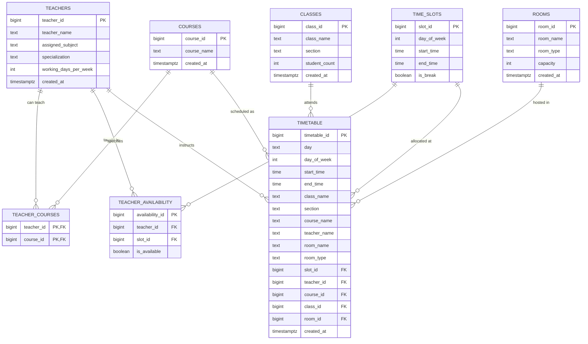

# Database & Persistence Architecture — SchedX

> **Document Version**: 2.0.0  
> **Status**: `Confirmed` Database Specifications from Active Repository Evidence  
> **Target Audience**: Database Administrators, Backend Engineers, System Architects, AI Coding Agents  
> **Related Documents**: [ARCHITECTURE.md](ARCHITECTURE.md) | [PRD.md](PRD.md) | [API.md](API.md)

---

## 1. Database Technology Overview

SchedX uses a **hybrid dual-tier persistence system**:
1. **Cloud Database**: **Supabase PostgreSQL** (Hosted PostgreSQL 15+).
   - Provides strict relational integrity, foreign key cascading constraints, unique 3-way collision prevention constraints, and Row Level Security (RLS).
   - Accessed via `@supabase/supabase-js` using standard PostgREST queries.
2. **Local Disk Storage**: **JSON-based Document Engine** located in `data/`.
   - Houses structured JSON stores that act as an instant local cache and resilient offline fallback whenever Supabase credentials are missing, network connectivity drops, or query execution exceeds 250ms–1000ms deadlines.

---

## 2. Entity-Relationship (ER) Diagram

The following Mermaid diagram represents the relational schema defined in `database/supabase_schema.sql` and supported by active application queries in `server.js`:



---

## 3. Relational Table Specifications (`database/supabase_schema.sql`)

### 3.1 `public.teachers`
Stores faculty profiles and baseline institutional constraints.

| Column Name | Data Type | Constraints | Description |
|---|---|---|---|
| `teacher_id` | `BIGINT` | `GENERATED BY DEFAULT AS IDENTITY PRIMARY KEY` | Unique faculty identifier. |
| `teacher_name` | `TEXT` | `NOT NULL` | Full instructor name. |
| `assigned_subject`| `TEXT` | `NULL` | Primary subject qualification. |
| `specialization` | `TEXT` | `NULL` | Department or academic area. |
| `working_days_per_week` | `INTEGER` | `DEFAULT 5 CHECK (working_days_per_week BETWEEN 1 AND 7)` | Weekly on-duty quota. |
| `created_at` | `TIMESTAMPTZ` | `DEFAULT NOW()` | Record creation timestamp. |

### 3.2 `public.courses`
Stores academic courses and subject curriculum titles.

| Column Name | Data Type | Constraints | Description |
|---|---|---|---|
| `course_id` | `BIGINT` | `GENERATED BY DEFAULT AS IDENTITY PRIMARY KEY` | Unique course identifier. |
| `course_name` | `TEXT` | `NOT NULL` | Course/subject title (e.g. "DBMS"). |
| `created_at` | `TIMESTAMPTZ` | `DEFAULT NOW()` | Record creation timestamp. |

### 3.3 `public.teacher_courses`
Represents the many-to-many relationship defining which teacher can teach which course.

| Column Name | Data Type | Constraints | Description |
|---|---|---|---|
| `teacher_id` | `BIGINT` | `REFERENCES public.teachers(teacher_id) ON DELETE CASCADE` | Foreign key to `teachers`. |
| `course_id` | `BIGINT` | `REFERENCES public.courses(course_id) ON DELETE CASCADE` | Foreign key to `courses`. |
| **PRIMARY KEY** | `(teacher_id, course_id)` | Composite Primary Key | Composite key preventing duplicate bindings. |

### 3.4 `public.classes`
Stores student cohort, batch, and section designations.

| Column Name | Data Type | Constraints | Description |
|---|---|---|---|
| `class_id` | `BIGINT` | `GENERATED BY DEFAULT AS IDENTITY PRIMARY KEY` | Unique class cohort identifier. |
| `class_name` | `TEXT` | `NOT NULL` | Department/program label (e.g. "CSE"). |
| `section` | `TEXT` | `DEFAULT 'A'` | Cohort section code (e.g. "A", "B"). |
| `student_count` | `INTEGER` | `NOT NULL CHECK (student_count > 0)` | Number of enrolled students. |
| `created_at` | `TIMESTAMPTZ` | `DEFAULT NOW()` | Record creation timestamp. |
| **UNIQUE** | `(class_name, section)` | `CONSTRAINT uq_class_section` | Ensures no duplicate sections per class. |

### 3.5 `public.rooms`
Stores campus classrooms and specialized laboratories with capacity validation.

| Column Name | Data Type | Constraints | Description |
|---|---|---|---|
| `room_id` | `BIGINT` | `GENERATED BY DEFAULT AS IDENTITY PRIMARY KEY` | Unique room identifier. |
| `room_name` | `TEXT` | `NOT NULL UNIQUE` | Unique room designation (e.g. "101", "Lab-201"). |
| `room_type` | `TEXT` | `NOT NULL CHECK (room_type IN ('Classroom', 'Laboratory'))` | Physical space classification. |
| `capacity` | `INTEGER` | `NOT NULL CHECK (capacity > 0)` | Maximum student seating capacity. |
| `created_at` | `TIMESTAMPTZ` | `DEFAULT NOW()` | Record creation timestamp. |

### 3.6 `public.time_slots`
Represents scheduled periods across days of the week (`1 = Monday` through `7 = Sunday`).

| Column Name | Data Type | Constraints | Description |
|---|---|---|---|
| `slot_id` | `BIGINT` | `GENERATED BY DEFAULT AS IDENTITY PRIMARY KEY` | Unique time slot identifier. |
| `day_of_week` | `INTEGER` | `NOT NULL CHECK (day_of_week BETWEEN 1 AND 7)` | Day integer (`1 = Monday`, `7 = Sunday`). |
| `start_time` | `TIME` | `NOT NULL` | Scheduled period start time (`HH:MM:SS`). |
| `end_time` | `TIME` | `NOT NULL` | Scheduled period end time (`HH:MM:SS`). |
| `is_break` | `BOOLEAN` | `DEFAULT FALSE` | Flag for tea, lunch, or short breaks. |
| **UNIQUE** | `(day_of_week, start_time, end_time)` | `CONSTRAINT uq_day_time_slot` | Eliminates duplicate period slots. |

### 3.7 `public.teacher_availability`
Stores explicit faculty slot availability derived from the teacher availability diary.

| Column Name | Data Type | Constraints | Description |
|---|---|---|---|
| `availability_id` | `BIGINT` | `GENERATED BY DEFAULT AS IDENTITY PRIMARY KEY` | Unique record identifier. |
| `teacher_id` | `BIGINT` | `REFERENCES public.teachers(teacher_id) ON DELETE CASCADE` | Foreign key to `teachers`. |
| `slot_id` | `BIGINT` | `REFERENCES public.time_slots(slot_id) ON DELETE CASCADE` | Foreign key to `time_slots`. |
| `is_available` | `BOOLEAN` | `DEFAULT TRUE` | Availability flag (`true` = available). |
| **UNIQUE** | `(teacher_id, slot_id)` | `CONSTRAINT uq_teacher_slot` | One availability status per slot per teacher. |

### 3.8 `public.timetable`
Stores generated, conflict-free institutional timetable records.

| Column Name | Data Type | Constraints | Description |
|---|---|---|---|
| `timetable_id` | `BIGINT` | `GENERATED BY DEFAULT AS IDENTITY PRIMARY KEY` | Unique generated timetable entry ID. |
| `day` | `TEXT` | `NOT NULL` | Day title (e.g. "Monday"). |
| `day_of_week` | `INTEGER` | `NOT NULL CHECK (day_of_week BETWEEN 1 AND 7)` | Numeric day index. |
| `start_time` | `TIME` | `NOT NULL` | Class period start time. |
| `end_time` | `TIME` | `NOT NULL` | Class period end time. |
| `class_name` | `TEXT` | `NOT NULL` | Academic class program title. |
| `section` | `TEXT` | `NOT NULL DEFAULT 'A'` | Target section. |
| `course_name` | `TEXT` | `NOT NULL` | Scheduled course/subject title. |
| `teacher_name` | `TEXT` | `NOT NULL` | Assigned instructor name. |
| `room_name` | `TEXT` | `NOT NULL` | Assigned classroom or laboratory. |
| `room_type` | `TEXT` | `NOT NULL DEFAULT 'Classroom'` | Space type assigned (`Classroom` or `Laboratory`). |
| `slot_id` | `BIGINT` | `REFERENCES public.time_slots(slot_id) ON DELETE SET NULL` | Reference to slot definition. |
| `teacher_id` | `BIGINT` | `REFERENCES public.teachers(teacher_id) ON DELETE SET NULL` | Reference to faculty profile. |
| `course_id` | `BIGINT` | `REFERENCES public.courses(course_id) ON DELETE SET NULL` | Reference to course profile. |
| `class_id` | `BIGINT` | `REFERENCES public.classes(class_id) ON DELETE SET NULL` | Reference to student class. |
| `room_id` | `BIGINT` | `REFERENCES public.rooms(room_id) ON DELETE SET NULL` | Reference to room. |
| `created_at` | `TIMESTAMPTZ` | `DEFAULT NOW()` | Record generation timestamp. |

---

## 4. Conflict Prevention Database Constraints

The `public.timetable` table implements the **Core Triple-Guard** at the PostgreSQL engine level via three explicit unique constraints:

```sql
-- 1. Faculty Collision Prevention:
-- Same teacher cannot instruct two distinct classes at the same day + start time
CONSTRAINT uq_day_time_teacher UNIQUE (day_of_week, start_time, teacher_name),

-- 2. Student Cohort Collision Prevention:
-- Same student section cannot attend two distinct classes at the same day + start time
CONSTRAINT uq_day_time_section UNIQUE (day_of_week, start_time, section),

-- 3. Room / Facility Collision Prevention:
-- Same room cannot host two distinct classes at the same day + start time
CONSTRAINT uq_day_time_room UNIQUE (day_of_week, start_time, room_name)
```

---

## 5. Performance Indexes

High-performance B-tree indexes defined in `database/supabase_schema.sql`:

```sql
CREATE INDEX IF NOT EXISTS idx_timetable_slot ON public.timetable(slot_id);
CREATE INDEX IF NOT EXISTS idx_timetable_teacher ON public.timetable(teacher_id);
CREATE INDEX IF NOT EXISTS idx_timetable_course ON public.timetable(course_id);
CREATE INDEX IF NOT EXISTS idx_timetable_class ON public.timetable(class_id);
CREATE INDEX IF NOT EXISTS idx_timetable_room ON public.timetable(room_id);
CREATE INDEX IF NOT EXISTS idx_time_slots_day ON public.time_slots(day_of_week);
CREATE INDEX IF NOT EXISTS idx_teacher_avail_teacher ON public.teacher_availability(teacher_id);
```

---

## 6. Migration Variants & UUID Schema (`supabase/schema.sql`)

In addition to the canonical identity-based schema above, the repository contains a modernized UUID-based migration variant in `supabase/schema.sql`:
- **Primary Keys**: Uses `uuid default gen_random_uuid()` via `pgcrypto`.
- **Row Level Security (RLS)**: Explicitly enabled on all tables:
  ```sql
  alter table public.teachers enable row level security;
  alter table public.subjects enable row level security;
  alter table public.classes enable row level security;
  alter table public.rooms enable row level security;
  alter table public.timetable enable row level security;
  alter table public.timetable_error_reports enable row level security;
  ```
- **Development RLS Policies**: Permissive access policies are created for development:
  ```sql
  create policy "development access timetable" on public.timetable 
    for all to anon, authenticated using (true) with check (true);
  ```
- **Incremental Migrations**:
  - `supabase/rooms-migration.sql`: Extends `room_type` check constraint to include `'Seminar Hall'`, `'Computer Lab'`, `'Other'` and adds `availability` text status (`Available`, `Occupied`, `Unavailable`).
  - `supabase/teacher-info-migration.sql`: Adds `department`, `email`, and `availability jsonb` to faculty records.

---

## 7. Local File Persistence Schema (`data/`)

When Supabase is unavailable, local JSON files maintain full state parity:

| File Path | Entity Schema | Record Example |
|---|---|---|
| `data/departments.json` | `[{ id, name, code }]` | `[{"id":"cse","name":"Computer Science & Engineering","code":"CSE"}]` |
| `data/breaks.json` | `[{ name, day, start_time, end_time, type, department }]` | `[{"name":"Lunch Break","day":"Monday","start_time":"12:20:00","end_time":"13:00:00","type":"Lunch Break"}]` |
| `data/rooms.json` | `[{ id, room_number, room_type, capacity, availability }]` | `[{"id":"101","room_number":"101","room_type":"Classroom","capacity":60,"availability":"Available"}]` |
| `data/teachers.json` | `[{ id, name, assigned_subject, assigned_subjects, specialization, working_days_per_week }]` | `[{"id":"t_1","name":"Rahul","assigned_subjects":["dbms","dsa"],"specialization":"Computer Science","working_days_per_week":5}]` |
| `data/timetable_store.json` | `[{ timetable_id, department, day, period_number, start_time, end_time, class_name, section, course_name, teacher_name, room_name, room_type, session_type, duration, has_conflict }]` | Array of all active generated schedule slots. |
| `data/timetable_history.json` | `[{ version_id, timestamp, is_active, department, status, summary, conflicts, entries, working_days, day_periods, teacher_workload }]` | Array of last 2 retained generation snapshots. |
| `data/todos.json` | `[{ id, title, date, time, category, completed, created_at }]` | Array of interactive calendar to-do items. |

---

## 8. Seed Data

`database/supabase_schema.sql` provisions default seed rooms and standard 1-hour time slots:
- **Default Rooms**:
  - `Classroom-101` (Classroom, Capacity: 60)
  - `Classroom-102` (Classroom, Capacity: 70)
  - `Classroom-103` (Classroom, Capacity: 50)
  - `Lab-201` (Laboratory, Capacity: 40)
  - `Lab-202` (Laboratory, Capacity: 45)
- **Default Standard Slots**: 7 standard 1-hour slots generated for Monday (1) through Friday (5) between 09:00 and 16:00, including an automatic 12:00–13:00 lunch break slot.

---

## 9. Backup & Disaster Recovery Considerations

1. **Local File Backups**:
   - The repository maintains automated snapshot backups: `data/timetable_history.backup.json` and `data/timetable_store.backup.json`.
   - Backup files are updated prior to major generation overwrites.
2. **Supabase Cloud Snapshots**:
   - Supabase automatically takes daily physical WAL backups.
   - Database schema can be completely re-instantiated at any time by executing `database/supabase_schema.sql`.

---
&copy; 2025–2026 SchedX Database Architecture Team.
