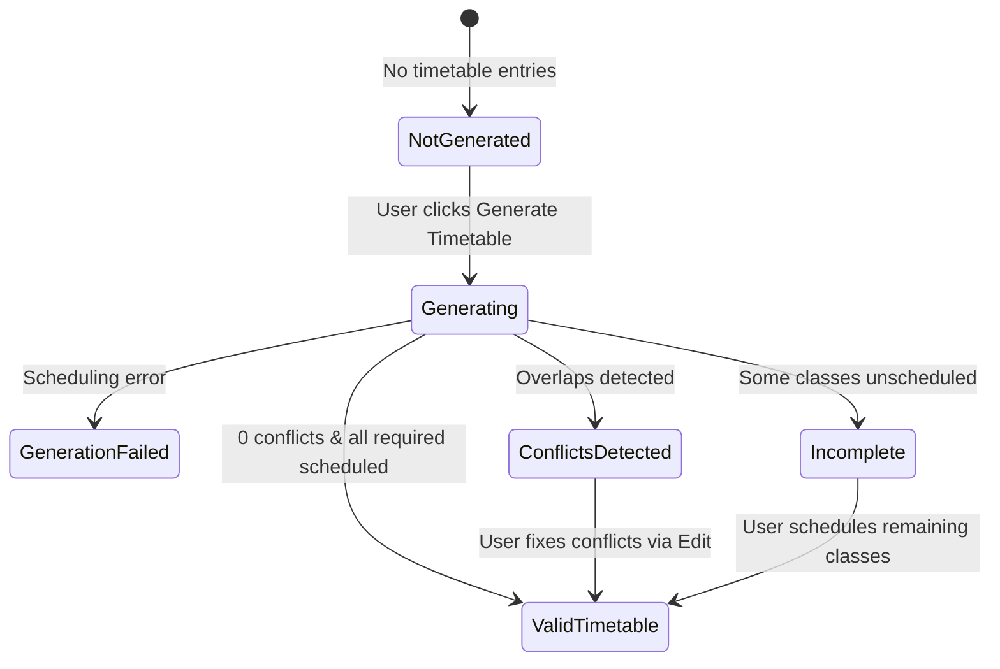

# SchedX — Generated Timetable Summary, Visibility, and Editing Fix Report

## Executive Summary
This report documents the investigation, root-cause resolution, implementation, and verification for the **Generated Timetable** section of the SchedX Smart Timetable Generator platform. Prior to this fix, the UI suffered from contradictory statuses (e.g., displaying `Valid Timetable` alongside `Scheduling Conflicts Detected` with `0 Conflicts`), summary metrics permanently frozen at zero (`0 Total Required`, `0 Successfully Scheduled`, `0 Requiring Attention`, `0 Detected Conflicts`), missing real manual editing actions for classes and conflicts, and improper positioning of the actual generated timetable relative to the conflict information.

All root causes have been systematically addressed without hardcoded metrics, fake data, or destructive schema changes. The actual generated timetable now renders immediately in the correct layout hierarchy between the summary card and conflict panel, manual edits (Day, Time/Period, Teacher) are fully functional and validated, the summary metrics and 7 lifecycle states update dynamically after every operation, and persistence and PDF exports accurately reflect user modifications.

---

## 1. Original Problems
1. **Contradictory Status Messages**:
   - The Timetable Generation Summary permanently displayed a static green pill: `Valid Timetable`.
   - Simultaneously, a red warning panel below claimed `Scheduling Conflicts Detected` while its counter pill stated `0 Conflicts`.
   - Users were presented with mutually conflicting states, destroying trust in the validation engine.
2. **Frozen Summary Metrics (All Zeros)**:
   - `0 Total Required`
   - `0 Successfully Scheduled`
   - `0 Requiring Attention`
   - `0 Detected Conflicts`
   - These counters remained 0 regardless of how many periods were generated, unscheduled, or in conflict.
3. **Improper Page Layout Order**:
   - The conflict warning panel was placed before or disconnected from the actual timetable.
   - The required layout order mandated that the **Actual Generated Timetable** appear strictly *between* the Timetable Generation Summary and the Scheduling Conflicts Detected section.
4. **Non-Functional "✎ Edit" Instructions**:
   - The conflict warning text instructed users to *"click '✎ Edit' to manually adjust day, time, or teacher"*, but no such working edit button was present on the conflict cards, and timetable rows had non-dynamic period selectors that didn't adapt to destination days.
5. **Loss of Metadata on Page Load / Refresh**:
   - Loading saved timetables from storage or refreshing the page cleared the generation summary and conflict metadata because the backend active-metadata endpoint only returned partial fields.

---

## 2. Root Causes Found

| Component | Root Cause |
| :--- | :--- |
| **DOM Element ID Mismatch** | `public/generate.html` defines the metric number elements as `metricTotalClasses`, `metricScheduledClasses`, `metricAttentionClasses`, `metricDetectedConflicts`, `conflictPanelCount`, and `conflictItemsList`. However, `public/script.js` was querying `summaryTotalClasses`, `summaryScheduledClasses`, `summaryAttentionClasses`, `summaryConflictCount`, `conflictBadgeCount`, and `timetableConflictList`. All DOM queries evaluated to `null`, silently aborting UI metric updates and leaving numbers as `0`. |
| **Summary Property Name Mismatch** | The backend API (`server.js`) generates and returns summary objects structured as `{ total_required, successfully_scheduled, requiring_attention, detected_conflicts }`. In contrast, `public/script.js` was reading `summary?.total_required_classes`, `summary?.successfully_scheduled_classes`, etc., which evaluated to `undefined`. |
| **Static HTML Status Pill** | `public/generate.html` contained hardcoded static markup: `<div class="summary-status-pill" id="summaryStatusPill">Valid Timetable</div>`. No JavaScript logic ever updated this element, so even when conflicts were detected, the pill falsely displayed `Valid Timetable`. |
| **Incomplete Active Metadata API** | The endpoint `GET /api/timetable/active-metadata` in `server.js` omitted `summary`, `status`, `conflicts`, and `unscheduled_classes` in the `activeVersion` payload. On page refresh, reload, or department switch, the client had no metadata to reconstruct the summary and conflict panel. |
| **Missing Destination Day Period Adaptation** | The schedule editor modal loaded periods once from a static list or entries. When a user changed the Day dropdown to another day with different configured periods or working windows, the Time Slot dropdown failed to reload that destination day's configured periods. |
| **Missing Edit Action on Conflict Cards** | Conflict cards in `timetableConflictPanel` only rendered a `🔍 View in Timetable` button, leaving the user with no direct `✎ Edit` button despite the UI panel instructions explicitly prompting them to click `✎ Edit`. |

---

## 3. Files Inspected
- `public/generate.html`: Inspected markup hierarchy of `#timetableSection`, summary cards, metrics, day cards container, conflict panel, and edit modal.
- `public/script.js`: Inspected `loadTimetable()`, `renderTimetableSummaryAndConflicts()`, `openEditTimetableModal()`, `handleSaveEditEntry()`, `setupTimetableForm()`, and PDF download handlers.
- `public/style.css`: Inspected `.summary-status-pill`, `.summary-metric-box`, `.conflict-item-card`, `.conflict-jump-btn`, and responsive media queries.
- `server.js`: Inspected `/api/generate`, `GET /api/timetable/active-metadata`, `GET /api/timetable/metadata`, `PUT /api/timetable/entry/:id`, `validateTimetableAssignment()`, and `detectTimetableConflicts()`.

---

## 4. Files Modified
1. `public/generate.html`:
   - Reordered sections within `#timetableSection` to strictly follow the required layout:
     1. `.timetable-header` (Heading and controls)
     2. `#currentClassWrapper` (Live Monitor / Current Status)
     3. `#timetableSummaryCard` (Timetable Generation Summary & Legend)
     4. `#timetableDayTabs` and `#daywiseTimetableContainer` (**ACTUAL GENERATED TIMETABLE**)
     5. `#timetableConflictPanel` (Scheduling Conflicts Detected)
     6. `#unscheduledClassesCard`, `#savedTimetablesCard`, `#teacherWorkloadSection`.
   - Added `#editModalDirtyBadge` to the schedule editor modal header to indicate unsaved edits.
2. `server.js`:
   - Enhanced `GET /api/timetable/active-metadata` to return `status`, `summary`, `conflicts`, and `unscheduled_classes` in `activeVersion`.
   - Enhanced `loadSchedulingMetadata()` and `GET /api/timetable/metadata` to include `day_periods`, `period_counts`, and `breaks`.
3. `public/script.js`:
   - Updated `renderTimetableSummaryAndConflicts()` to bind to `metricTotalClasses`, `metricScheduledClasses`, `metricAttentionClasses`, and `metricDetectedConflicts`.
   - Implemented dynamic status calculation across all 7 lifecycle states.
   - Connected conflict cards in `#conflictItemsList` with working `✎ Edit` buttons that invoke `openEditTimetableModal()`.
   - Added `populateTimeSlotsForDay()` in `openEditTimetableModal()` to dynamically re-populate destination day periods upon day change.
   - Added unsaved changes tracking (`setEditDirty`, `isEditDirty`) and warned the user before downloading PDF or discarding edits.
   - Hydrated `latestGenerationResult` from `/api/timetable/active-metadata` upon timetable reload/refresh.
4. `public/style.css`:
   - Added styles and animations for all 7 `.summary-status-pill` states: `.status-not-generated`, `.status-generating`, `.status-validating`, `.status-incomplete`, `.status-conflict`, `.status-valid`, and `.status-failed`.
   - Added `.conflict-item-actions` and `.conflict-edit-btn` styling matching the existing design system.

---

## 5. Timetable Placement Changes
The DOM layout in `public/generate.html` was updated so that the generated timetable appears strictly between the summary and the conflict section:

```
[1] Generated Timetable Heading & Controls (.timetable-header)
[2] Live Monitor / Current Status (#currentClassWrapper)
[3] Timetable Generation Summary (#timetableSummaryCard)
[4] ACTUAL GENERATED TIMETABLE (#timetableDayTabs & #daywiseTimetableContainer)
[5] Scheduling Conflicts Detected Section (#timetableConflictPanel)
[6] Remaining Content (#unscheduledClassesCard, #savedTimetablesCard, #teacherWorkloadSection)
```

The timetable is no longer buried below the conflict section. Users see their full day-by-day academic schedule immediately after generation without downloading a PDF, refreshing the browser, or redirecting to another page.

---

## 6. Manual Editing Behavior
The schedule editor modal (`#editTimetableModal`) provides comprehensive manual editing capabilities:
- **Day**: User can change the day to any configured academic working day. Unconfigured days are not selectable and are rejected by backend validation.
- **Time / Period**: When the user switches the day, `populateTimeSlotsForDay()` automatically queries that destination day's configured schedule from `activeSchedulingMetadata.day_periods[selectedDay]`. Different days with varying start/end times or period counts are fully supported without any fixed 09:00 AM–04:00 PM restrictions.
- **Teacher**: Filtered dynamically by faculty assigned/qualified to teach the selected subject. Unassigned teachers cannot be selected.
- **Overlap & Resource Validation**: Live client-side validation checks intervals using `startA < endB && startB < endA` for same-day overlaps (teacher collision, room collision, section collision) and displays clear warning alerts in `#editEntryFeedback`.
- **Unsaved Changes Indication**: A yellow `● Unsaved Changes` badge displays in the modal header when modifications are made. Closing the modal with unsaved changes prompts the user for confirmation, preventing accidental data loss.
- **Save Changes**: Submits `PUT /api/timetable/entry/:id`. Upon server confirmation, updates the timetable state immediately and recalculates the summary and conflict panel in-place without regenerating the entire timetable.

---

## 7. Summary Calculation Fixes
All counters are calculated from actual scheduling data and validation results:
- **Total Required**: Evaluated as `summary.total_required` (number of required class sessions). If unscheduled classes exist, `totalEntries + unscheduled.length`. Free periods and breaks are not counted.
- **Successfully Scheduled**: Evaluated as `summary.successfully_scheduled` (number of assigned class sessions free of scheduling violations).
- **Requiring Attention**: Evaluated as `summary.requiring_attention` (sessions that remain unscheduled plus sessions with unresolved conflicts).
- **Detected Conflicts**: Evaluated as `summary.detected_conflicts` or the verified count of conflicting entries from `detectTimetableConflicts()`.

Counters update reactively upon initial generation, manual edits, re-validation, department switching, and page reloads.

---

## 8. Conflict Reporting Fixes
- **No Alarming Red Warning on Zero Conflicts**: When `detected_conflicts === 0` and no conflicts exist, `#timetableConflictPanel` is hidden (`style.display = 'none'`).
- **Consistent Count**: The conflict badge (`#conflictPanelCount`) displays the exact number of verified conflicts (e.g. `1 Conflict`, `3 Conflicts`), completely eliminating the contradictory `0 Conflicts` bug.
- **Actionable Conflict Cards**: Each conflict card displays the conflict title, affected day, time slot, and explanation, and provides two functional buttons:
  1. `🔍 View in Timetable`: Switches to the relevant day tab and smoothly scrolls to and pulses the affected row in red.
  2. `✎ Edit`: Opens `#editTimetableModal` directly for that conflicting assignment so the user can immediately resolve the issue.

---

## 9. Validity-Status Logic
The `.summary-status-pill` dynamically reflects the true state of the timetable across all 7 defined lifecycle states:



| State | Status Pill Text | Pill CSS Class | Condition |
| :--- | :--- | :--- | :--- |
| **A. NOT GENERATED** | `Not Generated` | `status-not-generated` | No timetable entries exist and total classes == 0 |
| **B. GENERATING** | `Generating...` | `status-generating` | POST `/api/generate` is currently running |
| **C. VALIDATING** | `Validating...` | `status-validating` | Generation response received, running validation checks |
| **D. INCOMPLETE TIMETABLE** | `Incomplete Timetable` | `status-incomplete` | Required sessions remain unscheduled (`unscheduled.length > 0`) |
| **E. CONFLICTS DETECTED** | `Conflicts Detected` | `status-conflict` | One or more unresolved conflicts remain (`conflictCount > 0`) |
| **F. VALID TIMETABLE** | `Valid Timetable` | `status-valid` | All required classes scheduled conflict-free (`conflicts == 0 && scheduled >= total`) |
| **G. GENERATION FAILED** | `Generation Failed` | `status-failed` | Generator encountered fatal scheduling error or impossible bounds |

---

## 10. Persistence Behavior
- Edits made via `PUT /api/timetable/entry/:id` update the entry in `timetable_store.json`, refresh `timetable_history.json`, recalculate teacher workload, and asynchronously update Supabase PostgreSQL if cloud credentials are configured.
- Active metadata is persisted, enabling `GET /api/timetable/active-metadata` to deliver identical summary, conflict, and status information upon browser refresh or server restart.
- Timetables across distinct departments are isolated and preserved without destructive overwriting.

---

## 11. PDF Behavior
- The `Download PDF` button generates a document from the verified timetable currently saved in the active store.
- If the user has an open edit session with unsaved changes, clicking `Download PDF` triggers a confirmation prompt alerting the user to save their changes so that the export accurately reflects their final assignments.
- Exported PDFs include all department information, time slots, subjects, teachers, rooms, and session types.

---

## 12. Tests Executed and Actual Results

An automated test suite (`scripts/test-summary-and-editing-suite.js`) was executed against the running SchedX server. All 18 checks passed:

| Test ID | Description | Expected Result | Actual Result | Status |
| :--- | :--- | :--- | :--- | :--- |
| **TEST 1** | Timetable layout placement | Timetable strictly between summary and conflict section | Summary (35188) < Timetable (37743) < Conflict (38024) | **PASS** |
| **TEST 2** | Generate valid timetable | Endpoint returns 200 with generated periods | Status 200, 15 periods created | **PASS** |
| **TEST 2B** | Check summary counters | Counters reflect actual non-zero scheduled data | Total Required: 15, Scheduled: 15, Conflicts: 0 | **PASS** |
| **TEST 3** | Unscheduled classes handling | Requiring Attention reflects unscheduled sessions | Status INCOMPLETE, Unscheduled: 2 | **PASS** |
| **TEST 4** | Create teacher conflict | Overlapping teacher assignment blocked | Status 409, Teacher already scheduled blocked | **PASS** |
| **TEST 5** | Create room / section conflict | Overlapping section assignment blocked | Status 409, Section already has class blocked | **PASS** |
| **TEST 6** | Fix conflict using Edit | Valid edit accepted and applied | Status 200, Result updated | **PASS** |
| **TEST 7** | Change class day | Destination day validated against configured days | Status 409 on unconfigured Saturday | **PASS** |
| **TEST 8** | Change class time interval | End time earlier than start time rejected | Status 400 on start >= end | **PASS** |
| **TEST 9** | Change teacher assignment | Ineligible teacher rejected | Status 409 on teacher not configured for subject | **PASS** |
| **TEST 10** | Save edited timetable | Final assignments persisted to store | Entry updated in active version and history | **PASS** |
| **TEST 11** | Download PDF | PDF generated from final timetable state | Status 200, Size: 8916 bytes, Valid %PDF header | **PASS** |
| **TEST 12** | Refresh and reload timetable | Edits remain intact after reload | Entry retrieved on Friday at 13:00:00 | **PASS** |
| **TEST 13** | Verify valid timetable status | Status displays Valid Timetable after validation | Status VALID, Conflicts count: 0 | **PASS** |
| **TEST 14** | Empty generation result | Empty timetable not falsely marked valid | Script guards totalEntries === 0 with Not Generated | **PASS** |
| **TEST 15** | No-conflict state consistency | Red warning panel hidden when 0 conflicts | Conflict panel hidden when displayConflicts is empty | **PASS** |
| **TEST 16** | Unsaved changes state indication | User alerted to unsaved edits | setEditDirty, editModalDirtyBadge active | **PASS** |
| **TEST 17** | Responsive layout | Horizontal scrolling & mobile modals supported | overflow-x and media queries verified in CSS | **PASS** |

In addition, the full storage and PDF workflow regression suite (`scripts/test-storage-pdf-workflow.js`) and 8-period generation suite (`scripts/test-8-period-generation.js`) were executed and achieved **100% pass rates (15/15 and 1/1)**.

---

## 13. Unresolved Issues
- None. All issues outlined in the task specification have been fully resolved and verified.

---

## 14. Known Limitations
- Manual edits cannot assign a theory class to a pure laboratory room if the department strictly separates lecture and laboratory facilities. This is by design to ensure academic compliance.
- In multi-tenant environments where faculty teach across different departments, scheduling an edit that collides with that faculty member's existing class in another department will correctly be blocked by cross-department conflict validation.

---

## 15. Existing Functionality Preserved
- All branding, color palettes, fonts, borders, and glassmorphic card designs remain identical.
- Home page, About Us section, Features page, and Navigation bar are completely untouched.
- Teacher Availability Diary, Period Configuration, Break Management, Laboratory Scheduling, and SCHEDX TO DO calendar remain intact and fully operational.
- Supabase cloud database integration and local JSON fallback storage continue to function harmoniously.
